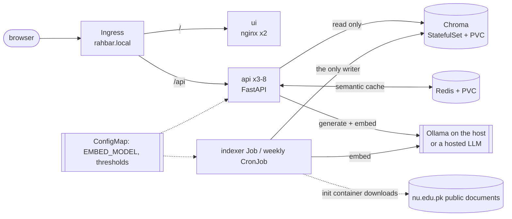

# RAHBAR: grounded question answering on Kubernetes

[](https://github.com/Sajawalkhan01/rahbar-grounded-rag/actions/workflows/ci.yml)
[](https://github.com/Sajawalkhan01/rahbar-grounded-rag/actions/workflows/cd.yml)

A student wants to know whether they can register for a course after failing its prerequisite.
The answer is in a clause of a PDF on the university website, superseded last year by a revised
policy that is also still on the website. A general-purpose language model will answer
confidently and describe some other university's rules, because it never read these ones.

RAHBAR answers **only from a real document corpus** (public FAST-NUCES documents), **cites the
passage** it used, prefers the **current** version of a policy over the superseded one, and
**declines** when the documents do not cover the question. It runs on Kubernetes, re-indexes
without a redeploy, scales horizontally, survives a deleted pod, and has a CI gate that fails
the build when retrieval quality drops.

## Architecture



Two paths that never share a process: the **indexer** writes the vector store on demand (a Job,
see `docs/adr/0001-indexer-as-job.md`) and the **api** only reads it on every question. Both
read the same `EMBED_MODEL` from one ConfigMap, and the api refuses to become ready if the index
was built with a different model (`docs/adr/0005-api-contract-additions.md`).

**Query path:** validate (3-500 chars) → semantic cache (skipped for follow-ups) → embed → hybrid
retrieval (dense + BM25, superseded documents filtered out unless the question asks for an old
version) → relevance floor (below it: decline, no model call) → augmented prompt → schema-constrained
generation → Pydantic validation, one retry, safe fallback → every citation checked against the
retrieved chunks → cache only what is safe to cache.

## Technology

Python 3.12, FastAPI, Pydantic · ChromaDB 1.0.12 · Redis 7.4 · Ollama (`nomic-embed-text` for
embeddings, `llama3.2:3b` for answers) or any OpenAI-compatible hosted API · pdfplumber, Tesseract,
poppler · nginx · Docker, Kubernetes (minikube + Calico), Kustomize · pytest, Ruff, mypy ·
GitHub Actions, kind, kubeconform, Trivy.

## Prerequisites

Linux, macOS or **Windows with WSL 2 (Ubuntu)**; do everything below inside Ubuntu.

| Tool | Notes |
| --- | --- |
| Python 3.12, `make`, `git` | `make install` builds a virtualenv |
| Docker | the minikube `docker` driver |
| minikube, kubectl | cluster with the Calico CNI (the default CNI ignores NetworkPolicy) |
| Ollama | `OLLAMA_HOST=0.0.0.0 ollama serve`, then `ollama pull nomic-embed-text` and `ollama pull llama3.2:3b` |
| 8 GB RAM free | 6 GB is the minikube default here; the 3B model needs about 3 GB more |

## Try it without a cluster

```bash
git clone https://github.com/Sajawalkhan01/rahbar-grounded-rag.git && cd rahbar-grounded-rag
make install          # .venv with the api, indexer and dev dependencies
make test             # unit tests: stubs only, no cluster, no model, no network
make lint             # ruff and mypy
make dev              # the API with stubs on http://localhost:8000, serving the chat UI too
```

## Deploy on minikube (the order matters)

```bash
# 1. The cluster, with Calico, metrics-server and the ingress addon
make cluster

# 2. The model host. In another terminal, and leave it running:
OLLAMA_HOST=0.0.0.0 ollama serve
ollama pull nomic-embed-text && ollama pull llama3.2:3b

# 3. The three images, built and loaded into minikube (tag "dev")
make images

# 4. Everything: namespace, config, Chroma, Redis, api, ui, HPA, Ingress, NetworkPolicies,
#    and the indexer Job (it downloads the corpus, OCRs the scans, embeds and stores)
kubectl apply -k k8s/overlays/dev

# 5. Wait for the index (the first run OCRs 32 scanned pages: expect 20-40 minutes)
kubectl wait --for=condition=complete job/indexer -n rahbar --timeout=90m
kubectl logs job/indexer -n rahbar -c indexer | tail

# 6. The api pods turn Ready once the collection is non-empty and the embedding pin matches
kubectl rollout status deployment/api -n rahbar
kubectl get pods,svc,ingress,hpa -n rahbar
```

If the host address of your minikube differs from `192.168.49.1`, edit
`k8s/overlays/dev/egress-llm-host.yaml` (`minikube ssh "grep host.minikube.internal /etc/hosts"`).

### Open the UI and ask a question

With the docker driver on macOS/Windows/WSL the minikube IP is not reachable from the host:

```bash
minikube tunnel                                   # in another terminal; leave it running
echo "127.0.0.1 rahbar.local" | sudo tee -a /etc/hosts
# browse to http://rahbar.local   (the chat page; answers show citations and the retrieved passages)

make ask INGRESS_IP=127.0.0.1 Q="What minimum CGPA avoids academic warning?"
make ask INGRESS_IP=127.0.0.1 Q="What is the curfew in the boys hostel?"     # declined: not in the corpus
kubectl delete pod -l app=api -n rahbar --field-selector=status.phase=Running | head -1   # then ask again
```

### Re-index without a redeploy

```bash
make index            # = kubectl create job --from=cronjob/reindex reindex-<time> -n rahbar
```

The CronJob also runs every Sunday at 03:00. A new `index_id` is written on each run, which
invalidates the semantic cache by itself.

### The LLM key (only for `LLM_PROVIDER=hosted`)

```bash
export LLM_API_KEY=...        # never put it in a file
make secret                   # kubectl create secret generic rahbar-secret -n rahbar ...
```

`k8s/base/secret.placeholder.yaml` shows the Secret's shape and is deliberately not applied.

## Configuration

One ConfigMap (`k8s/base/configmap.yaml`) feeds the api, the Job and the CronJob.

| Variable | Default | Meaning |
| --- | --- | --- |
| `EMBED_MODEL` | `nomic-embed-text` | the pin: indexer and api must agree; the api checks it against the index |
| `LLM_PROVIDER` | `ollama-host` | `stub`, `ollama-host`, `ollama-incluster`, `hosted` |
| `LLM_MODEL`, `OLLAMA_URL`, `HOSTED_BASE_URL` | see file | model name and endpoints |
| `LLM_API_KEY` | empty | **Secret only** |
| `TEMPERATURE` | `0.1` | facts and JSON belong at 0 to 0.3 |
| `TOP_K` | `5` | passages sent to the model |
| `RELEVANCE_FLOOR` | see file | below this best similarity the api declines without calling the model |
| `CACHE_THRESHOLD` | see file | cosine similarity for a semantic-cache hit |
| `CHUNK_SIZE`, `CHUNK_OVERLAP` | see file | words per chunk and shared words (measured: `docs/PIPELINE.md`) |
| `CHROMA_HOST/PORT/COLLECTION`, `REDIS_HOST/PORT` | `chroma`, `8000`, `rahbar`, `redis`, `6379` | service addresses |

## API

| Method | Path | Purpose |
| --- | --- | --- |
| GET | `/healthz` | liveness: is the process alive? touches nothing else |
| GET | `/readyz` | readiness: Chroma reachable, collection non-empty, embedding pin matches, Redis reachable; 503 names the failure |
| GET | `/metrics` | Prometheus text: requests, latency, retrieval and generation latency, cache hit ratio, abstentions, fallbacks, tokens |
| POST | `/api/ask` | `{"question": "...", "session_id": "optional"}` → answer, citations, `answered_from_context`, confidence, retrieved passages |

## Corpus

Nine public FAST-NUCES documents. The repository holds the list and checksums, not the PDFs:
[`corpus/sources.yaml`](corpus/sources.yaml), [`corpus/MANIFEST.md`](corpus/MANIFEST.md),
[`docs/CORPUS.md`](docs/CORPUS.md). Locally: `make fetch`, then `python corpus/fetch.py --verify`.
In the cluster the indexer Job's init container runs the same script.

## Evaluation

```bash
make eval                                     # the golden set (21 questions) through the Ingress
python eval/run_eval.py --api http://... --host rahbar.local --update-baseline   # after a deliberate improvement
```

CI fails when recall@5 drops more than 5 points below `eval/baseline.json`, when any must-abstain
question is answered from context, or when citation validity falls below 95%. Numbers and method:
[`docs/PIPELINE.md`](docs/PIPELINE.md).

## CI/CD and branches

`main` is protected (pull request, one approval, passing checks, no direct pushes); work happens on
`dev`. `.github/workflows/ci.yml` runs lint, tests (coverage ≥ 60%), manifest validation, image
builds, Trivy and an end-to-end evaluation on a kind cluster. `cd.yml` runs on a merge to `main`:
test → build and push images tagged with the **commit SHA** (never `latest`) → deploy to an
ephemeral kind cluster → rollout status → smoke test through the Ingress. Secrets:
`DOCKERHUB_USERNAME`, `DOCKERHUB_TOKEN`.

## Troubleshooting

Diagnose in this order: `kubectl get pods -n rahbar`, then `kubectl describe pod <pod> -n rahbar`
(read the Events), then `kubectl logs <pod> -n rahbar` (add `--previous` for a crashed container).

| Symptom | Usual cause | Fix |
| --- | --- | --- |
| `ImagePullBackOff` on a local image | minikube cannot see your Docker images | `make images`; manifests use `imagePullPolicy: IfNotPresent` |
| api `Running` but `0/1` | readiness says no: `kubectl get --raw` or `curl` `/readyz` names the check | empty collection (run the Job), embedding mismatch (see the log line), Chroma/Redis down |
| `chroma-0` `CrashLoopBackOff` with `CHROMA_PORT ... expected u16` | Kubernetes service-link variables | already fixed: `enableServiceLinks: false` |
| every service name stops resolving | default-deny egress blocks DNS | `k8s/base/networkpolicy.yaml` allows kube-dns on port 53 |
| api cannot reach Ollama | Ollama listens on 127.0.0.1, or the host IP in the egress policy is wrong | `OLLAMA_HOST=0.0.0.0`; check `k8s/overlays/dev/egress-llm-host.yaml` |
| indexer `OOMKilled`, exit code 137 | embedding and OCR hold more memory than serving | raise the Job's memory limit, guided by `kubectl top pods` |
| HPA shows `<unknown>/70%` | no CPU request, or metrics-server not enabled | `minikube addons enable metrics-server`; wait a minute |
| `ui` can reach `chroma` | cluster started without Calico | recreate it with `--cni=calico` |

## Screenshots and evidence

See [`docs/evidence/`](docs/evidence/) (branch protection, blocked and green pull requests,
`kubectl top pods`, endpoints, HPA, the Ingress answering, rollout and rollback, the
embedding-mismatch demonstration).

## Documentation

[`docs/CORPUS.md`](docs/CORPUS.md) · [`docs/PIPELINE.md`](docs/PIPELINE.md) ·
[`docs/FAILURE-ANALYSIS.md`](docs/FAILURE-ANALYSIS.md) · [`docs/ENGINEERING-NOTES.md`](docs/ENGINEERING-NOTES.md) ·
[`docs/AI-USAGE.md`](docs/AI-USAGE.md) · [`docs/adr/`](docs/adr/) · [`PROJECT-STATUS.md`](PROJECT-STATUS.md)

Licence: MIT for the code; the FAST-NUCES documents are not included and remain theirs.
